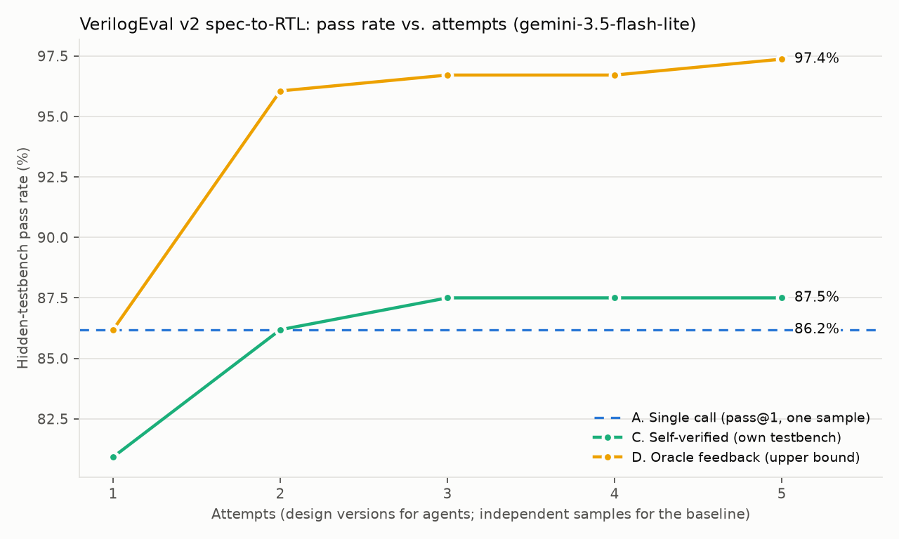

# Self-verifying LLM agent for RTL design

An agent that turns a plain-English hardware spec into Verilog, then compiles it, writes its own
testbench, simulates and revises the code. It is evaluated on [VerilogEval v2](https://github.com/NVlabs/verilog-eval)
(spec-to-RTL) against a single-call baseline.

> **Headline (gemini-3.5-flash-lite, all 152 problems):** the agent's self-written testbenches lifted
> its own designs from **80.9% → 87.5%** pass@1 (10 fixed, 0 regressed, McNemar p = 0.002) with no
> access to the reference tests, at **$0.013 per design**. FSM problems gained the most (56.7% → 70.0%
> vs. single call). Against an independent single-call baseline (86.2%) the end-to-end gain is
> **not significant** (+1.3 pts, 95% CI −3.9 to +6.6), and in **12.5%** of runs the agent signed off on a
> design its own tests passed but the hidden tests failed. With the reference results fed back (oracle),
> the same loop reaches **97.4%**: the gap is in test quality, not in the repair loop.



## The question

Iterative LLM agents for Verilog are well studied (AutoChip, RTLFixer, VerilogCoder, MAGE). Many
reported gains come from feeding the benchmark's own test results back to the model, which tunes the
design against the answer key. This project measures **how much of that gain survives when the agent
can only use feedback it could actually get in practice**, and how far it can trust its own tests.

## Experimental conditions

All iterative modes share one agent loop, system prompt and attempt budget (5 design versions). They
differ **only** in the feedback their tools return.

| Mode | Agent's tools | Feedback the model sees | What it measures |
|---|---|---|---|
| **A. Baseline** | none | none (one call) | pass@1, plus pass@5 over 5 samples |
| **B. Compile** | `write_design`, `submit` | Icarus Verilog errors and warnings for the design alone | syntax and elaboration repair |
| **C. Self-verified** | + `write_testbench`, `run_simulation` | compile output + **its own** testbench's results | autonomous verification (headline) |
| **D. Oracle** | `write_design`, `submit` | the **hidden reference testbench's** mismatch report | upper bound, not an autonomous result |

Scoring always uses the hidden reference testbench, and pass/fail matches VerilogEval's official
`sv-iv-analyze` rules. Every design version is scored for the pass-vs-attempts curve, but that score is
only shown to the model in mode D. A unit test (`tests/test_agent.py`) checks that no hidden-testbench
output reaches the model in mode C.

### Fairness controls
- **Equal compute:** the baseline is reported at pass@5 next to the agents' 5-attempt budget. pass@k
  assumes something can pick the right sample, so it overstates what a deployable system gets.
- **Uncertainty is reported:** pass@1 comes with a 95% bootstrap CI over problems, and each agent mode
  is compared to the baseline *paired by problem*. Use `AGENT_SAMPLES=3 make eval` for tighter intervals.
- **Cost is reported:** LLM calls, tokens and dollars per problem for each mode.
- **False confidence:** in mode C we track how often the agent's own testbench passed on the
  submitted design while the hidden one failed. That measures how often the agent signs off on a design
  whose hidden tests fail.

## Results

gemini-3.5-flash-lite, medium thinking, 152 problems, one sample per mode. Total API cost of the
whole study, including smoke tests, was about $3.70 (estimated from token counts at list prices).

| Mode | pass@1 | 95% CI | Δ vs. single call (paired) | LLM calls / problem | $ / problem |
|---|---|---|---|---|---|
| A. Single call | 86.2% | 80.9–91.4 | — | 1.0 | $0.004 |
| C. Self-verified (own testbench) | 87.5% | 82.2–92.1 | +1.3 (−3.9 to +6.6) | 5.8 | $0.013 |
| D. Oracle feedback (upper bound) | 97.4% | 94.7–99.3 | +11.2 (+5.9 to +17.1) | 2.2 | $0.007 |

What the numbers say:
- **The repair loop works; the tests are the bottleneck.** Given the hidden testbench's verdict, the
  agent fixes 17 designs and breaks none. With only its own testbench it fixes 10 and breaks none, but
  every one of its 19 remaining failures had passed its own tests.
- **The tool-using agent's first draft is weaker than a plain single call** (80.9% vs. 86.2%), which
  absorbs most of the loop's gain. Prompting for the first draft is the obvious next lever.
- **FSMs benefit most** from self-verification (56.7% → 70.0%); combinational problems are already
  near ceiling for single calls (96.3%).
- Mode B (compile feedback only) was run on the 20-problem smoke set but not the full benchmark,
  to stay within budget.

See [`results/summary.md`](results/summary.md) for the full tables: pass rates, cost, self-verification
reliability, results by category (combinational / sequential / FSM), failure breakdown, and problems
fixed by iteration. Full agent transcripts are in `results/<run>/transcripts/`.

## Reproduce

```bash
make setup                # icarus-verilog, VerilogEval v2 clone, Python deps (uv)
cp .env.example .env      # add your GEMINI_API_KEY
make test                 # harness: all 152 reference solutions must pass
make smoke                # 20 problems x 4 modes on a cheap model
make eval-budget          # reproduces the results above (baseline/self/oracle on flash-lite, ~$3)
make eval                 # all four modes on gemini-4-argon, then analysis
```

On a cloud-synced folder (OneDrive, Dropbox), set `VAGENT_WORK_DIR=~/vagent-work` so results and the
cache are written outside it; sync can otherwise block writes mid-run.

LLM responses are cached in `.cache/llm/`, so re-running replays them at no cost. Individual runs:
`uv run run_eval.py --mode self --model gemini-4-argon --limit 20`. Runs resume if interrupted.
Any `gemini-*` or `claude-*` model works (`MODEL=claude-sonnet-5-5 make eval`), so you can compare providers
on the same harness. `--effort low|medium|high` maps to Gemini's thinking level or Claude's effort.

## Layout

```
vagent/dataset.py   problem loading + 4 excluded problems (see below)
vagent/harness.py   iverilog compile/sim: hidden eval vs. agent-visible checks
vagent/llm.py       Gemini + Claude backends behind one interface, disk cache, cost accounting
vagent/agent.py     the four modes and the shared tool-using loop
run_eval.py         parallel, resumable experiment runner
analyze.py          tables + chart
tests/              harness validation and fake-LLM agent tests
```

## Notes and limitations

- **4 of 156 problems are excluded** because their own reference solutions fail the official criteria
  under Icarus Verilog 13. Prob099's testbench binds ports the reference doesn't have, and three
  testbenches run longer than their own `TIMEOUT` watchdog. `tests/test_harness.py` checks this.
  Waveform-dump lines are removed from testbenches because Icarus 13 rejects a forward reference in them.
- **Contamination:** VerilogEval problems come from HDLBits, which is public, so models may have seen
  them. Absolute pass rates are likely inflated. Differences between modes are the more meaningful result.
- **Category labels** (combinational / sequential / FSM) come from a simple heuristic on the reference code.
- **Nondeterminism:** sampling isn't seeded. Runs are reproducible through the response cache, and
  variance is reported through pass@k over samples.
- **Cost figures** use list prices from October 2026, including Google's promotional Gemini rates
  (`gemini-4-argon` doubles on 2026-12-01). See `PRICES` in `vagent/llm.py`.
- **Sandboxing:** generated Verilog runs under Icarus in throwaway temp directories with timeouts. It is
  not a security sandbox.
